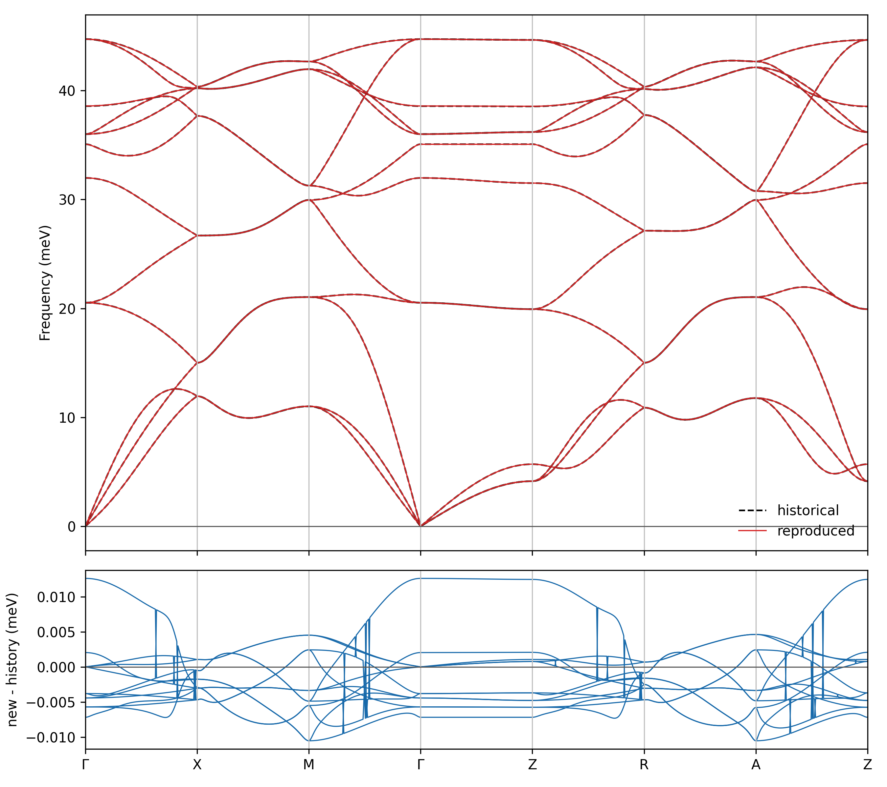

# FeSe U=J=0｜DFT energy → extended XYZ → GAP → Phonopy

這是一份給新進學生操作的完整範例。它保存歷史的 74 筆 CSC energy-only 資料與既有 GAP，不重新執行 VASP 或 DFT+gRISB，也不更動歷史模型；新訓練與新 Phonopy 結果一律寫到新的 output 路徑。

> 這是 U=J=0 的流程教學，不是 FeSe 強關聯物理的定量驗證。歷史資料有 74 筆紀錄，但只有 **59 個不同幾何構型**；frames 33–48 是同一幾何的 16 次重複紀錄。為保留可追溯性，XYZ 與原始模型均原樣保留。

> **歷史計算版本：** 本教材中的 DFT 與 GAP 聲子色散比較、GAP 振動熱性質，均對應當時以 **74 筆 CSC 能量訓練 GAP** 的工作流程，**不是教授後續更新 INCAR 等設定後重新計算的結果**。後續新版設定據作者經驗有更佳的電子計算收斂表現，但本教材沒有以新版重算聲子或證明其預測精度改善。新的 DFT+ghostGA 計算請參考 [FeSe/VASP 的最新版設定提醒](../../README.md#5-重要提醒)。

## 流程一覽

```text
DFT/CSC total energy
        ↓
extended XYZ（結構、晶格、energy）
        ↓
QUIP gap_fit（2-body + 3-body，energy-only）
        ↓
GAP E(R) 與 F=-∂E/∂R
        ↓
Phonopy finite displacement
        ↓
聲子色散、DOS、Cv、S、振動 Helmholtz free energy
```

Energy-only 是指訓練標記只有總能量；Phonopy 仍使用 GAP 對能量微分得到的預測力。詳細觀念見 [docs/concepts_and_faq.md](docs/concepts_and_faq.md)。

## 檔案與來源

```text
U0J0_pretest/
├── data/csc_data_74.xyz
├── model/
│   ├── csc_ver.xml
│   └── csc_ver.xml.sparseX.GAP_..._6711～6719
├── training/
│   ├── train_gap.sh
│   └── validate_retrained_model.py
├── scripts/
│   ├── check_assets.py
│   └── model_smoke_test.py
├── phonon/
│   ├── POSCAR
│   ├── CONTCAR
│   ├── csc_ver.yaml
│   ├── ground_truth.yaml
│   ├── reference_dft/FORCE_CONSTANTS
│   ├── run_gap_phonopy.py
│   ├── thermal.py
│   └── compare_phonons.py
├── results/
│   ├── phonon_comparison_historical.png
│   └── thermal_properties_historical.png
└── checksums.sha256
```

- `data/csc_data_74.xyz`：原始 74-frame extended XYZ，32 atoms/frame，energy 單位為整個構型的 eV。
- `model/csc_ver.xml`：歷史 GAP。XML 真正引用的是 `6711`–`6719` 共 9 個 SparseX；來源目錄中的 `6601`–`6609` 是內容相同但未被此 XML 引用的副本，故未納入。
- `phonon/POSCAR`、`CONTCAR`：原始來源目錄中的起始與歷史弛豫結構。歷史 `plot_phonon.py` 是從 POSCAR 做 hydrostatic cell relaxation；新的 `run_gap_phonopy.py` 保留這個選擇。
- `phonon/csc_ver.yaml`：歷史 GAP finite-displacement 資料，4×4×4 supercell。
- `phonon/ground_truth.yaml` 加 `reference_dft/FORCE_CONSTANTS`：DFT 比較所需資料。只提供 YAML 不足以重建此 DFT 曲線，因此一併保存 FORCE_CONSTANTS。
- `results/phonon_comparison_historical.png`：以 74 筆 CSC 能量訓練 GAP，使用 GAP 預測力經 Phonopy 算出的聲子色散，與**直接 DFT 聲子**比較；歷史圖中紅線標作 CSC，實際為 CSC-trained GAP。
- `results/thermal_properties_historical.png`：同一歷史 CSC-trained GAP／Phonopy 路線得到的 Phonon DOS、定容熱容、熵與 Helmholtz 自由能。
- 以上均由研究資料夾保留的**歷史圖**，不是本次重新計算或教授新版 INCAR 的成果。
- `checksums.sha256`：上述歷史輸入與輸出的 SHA-256，可用來確認沒有改動。

不要混用上一層的 `energy_only_dataset.xyz`；它是另一組 440×128 資料，訓練設定也不同。

## 環境

需要 Python、NumPy、ASE、Phonopy、Matplotlib，以及能與 ASE 搭配使用的 **QUIP／quippy**。第 4 關若要自行訓練 GAP，另外需要 QUIP 的 `gap_fit` 指令。

這份範例使用過的相容版本供參考（不代表只能使用這些版本）：

| 軟體 | 參考版本 |
| --- | --- |
| Python | 3.10 |
| NumPy | 1.26 |
| ASE | 3.28 |
| Phonopy | 3.2.1 |
| Matplotlib | 3.10 |
| QUIP | v0.10.2 |

`quippy` 是用 Python 呼叫 GAP 計算原子力的介面，`gap_fit` 則是 QUIP 的訓練工具；兩者不是同一個指令。可使用相容的 `quippy-ase`，或實驗室既有的 QUIP Python binding。後者可能需要 `f90wrap`，也可能必須將編譯路徑加入 `PYTHONPATH`。如需訓練，請確認 `gap_fit` 與目前的 compiler／MPI runtime 相容；本範例使用單一 `gap_fit` process，**不需要 `mpirun`**。

首次使用可確認：

```bash
python -c "import numpy, ase, phonopy, matplotlib; print('Python packages OK')"
python -c "from quippy.potential import Potential; print('quippy OK')"
command -v gap_fit  # 只有第 4 關重新訓練時才需要
```

如果 `quippy` 無法匯入，請先在實驗室環境載入正確的 Python／QUIP binding；不要直接修改教學腳本中的模型路徑或模型參數來解決匯入問題。

## 執行目錄（重要）

**以下所有教學指令都以 `FeSe/VASP/QUIP/U0J0_pretest/` 為目前工作目錄**，包括 `python scripts/...`、`python phonon/...` 和 `bash training/...`；不要直接在 GitHub repository 根目錄執行這些相對路徑指令。

第一次操作時，請先從 repository 根目錄進入教學資料夾：

```bash
cd FeSe/VASP/QUIP/U0J0_pretest
```

之後的各關都沿用此工作目錄。如果重新開啟終端機，請先確認 `pwd`，必要時重新切換到這個教學資料夾。**以下不再重複 `cd`**。

## 第 0 關：確認教學檔案

在上述教學資料夾執行：

```bash
sha256sum --check checksums.sha256
python scripts/check_assets.py
```

預期看到 SHA-256 全部 `OK`，以及：

```text
PASS XYZ: 74 records, 32 atoms each, 59 unique geometries
PASS model: XML parses and all 9 referenced SparseX MD5 values match
```

## 第 1 關：使用現成 GAP 模型計算聲子

### 1.1 驗證現成 GAP 模型

必要輸入是 `model/csc_ver.xml`、XML 引用的 9 個同目錄 SparseX，以及歷史 relaxed cell 所在的 `phonon/csc_ver.yaml`。先以 32-atom frame 做最低成本的模型讀取測試：

若 `quippy` 已安裝：

```bash
python scripts/model_smoke_test.py
```

如果 QUIP binding 位於自建目錄，可將路徑由環境指定，不要寫死進腳本：

```bash
export QUIP_PYTHON_BUILD=/path/to/QUIP/build/YOUR_QUIP_ARCH
PYTHONPATH="$QUIP_PYTHON_BUILD" python scripts/model_smoke_test.py
```

請將 `YOUR_QUIP_ARCH` 換成實際的 QUIP 編譯目錄名稱，勿直接使用範例路徑。

常見錯誤：

- `No module named quippy`：目前 Python 沒看到 QUIP binding。
- `No module named f90wrap`：binding 已找到，但此 Python 缺少 QUIP 建置時需要的 f90wrap。
- 找不到 SparseX：XML 與 9 個 SparseX 必須留在同一個 `model/`。
- MD5 mismatch：檔案被修改、改錯版本或複製不完整；先比對 `checksums.sha256`。

### 1.2 從結構產生聲子

確認既有 GAP 模型能讀取後，可用以下指令從 `phonon/POSCAR` 開始：

```bash
python phonon/run_gap_phonopy.py
```

程式先做 **hydrostatic cell relaxation**，再建立 4×4×4 supercell、產生 0.01 Å 的位移，以 GAP 計算原子力及 Phonopy 力常數，輸出新的聲子圖與 YAML。

```text
phonon/output/
├── CONTCAR_gap_reproduced
├── relax.log
├── relax.traj
├── csc_ver_reproduced.yaml
└── phonon_gap_reproduced.png
```

如果只想確認程式能執行，也可以用較小的超胞：

```bash
python phonon/run_gap_phonopy.py \
  --supercell 2 2 2 \
  --skip-relax \
  --output-dir phonon/output_smoke
```

**注意：** 跳過結構弛豫的 2×2×2 計算只是操作練習，未弛豫 POSCAR 可能產生明顯虛頻，不能當成正式物理結果。若 `output/` 已存在，請另用新輸出目錄，不要覆寫歷史資料。

### 1.3 重現歷史 4×4×4 聲子

若要重現當時的結果，請直接使用 `phonon/csc_ver.yaml` 內保存的 **hydrostatic-relaxed unit cell**，不要以未弛豫 POSCAR 或 fully relaxed CONTCAR 取代。

先讀取歷史 YAML 繪圖：

```bash
python phonon/redraw_historical.py \
  --output-dir phonon/output_history_redraw
```

接著以歷史模型重新計算 4×4×4 的位移力：

```bash
export OMP_NUM_THREADS=1
export OPENBLAS_NUM_THREADS=1
export MKL_NUM_THREADS=1
export NUMEXPR_NUM_THREADS=1

python phonon/reproduce_historical_4x4.py \
  --output-dir phonon/output_reproduction_4x4
```

輸出目錄內包含 `csc_ver_reproduced_4x4.yaml`、聲子圖及 `reproduction_metrics.json`。腳本會核對 0.01 Å 位移，計算未位移 supercell 的背景力，將背景力從位移後原子力扣除，再由 Phonopy 建立並對稱化力常數。

**為什麼需要這些步驟？** 有限位移方法透過位移與回復力求出二階力常數；結構未平衡、忘記扣除背景力、超胞或頻率單位不一致，都可能使聲子計算結果不同。

## 第 2 關：計算 Phonon DOS 與振動熱力學

使用第 1 關產生的 `phonon/output_reproduction_4x4/csc_ver_reproduced_4x4.yaml`。本步驟直接讀取已計算的力常數，**不必重新計算 GAP 原子力**。

```bash
python phonon/thermal.py \
  --input phonon/output_reproduction_4x4/csc_ver_reproduced_4x4.yaml \
  --historical-yaml phonon/csc_ver.yaml \
  --mesh 30 30 30 \
  --t-min 0 --t-max 1000 --t-step 10 \
  --output-dir phonon/output_thermal_reproduction
```

預期產生：

```text
phonon/output_thermal_reproduction/
├── thermal_properties_reproduced.png
├── thermal_properties.csv
├── phonon_dos.csv
└── thermal_metrics.json
```

**物理意義：** Phonon DOS 描述振動模態的頻率分布；定容熱容 `C_V` 在高溫下應趨近 **3 k_B/atom**（Dulong–Petit 極限）。熵和振動 Helmholtz 自由能則描述聲子對熱力學的貢獻。

Phonopy 的熱容／熵單位是 J/(K·mol primitive cell)，自由能是 kJ/mol primitive cell。本例 primitive cell 有 4 個原子，所以使用 `C_V/(4R)` 換算為 `k_B/atom`。如果將頻率軸從 THz 轉為 meV，DOS 縱軸也必須同步由 `1/THz` 換算為 `1/meV`。

常見錯誤：輸入 YAML 缺少力常數、輸出目錄已存在，或將 `30×30×30` 的 q-point mesh 誤認為原子超胞大小。

## 第 3 關：與 DFT 參考聲子比較

需要新產生的 GAP YAML，以及 `phonon/ground_truth.yaml` 和 `phonon/reference_dft/FORCE_CONSTANTS`。DFT YAML **必須搭配 FORCE_CONSTANTS** 才能重建這組參考聲子。

```bash
python phonon/compare_phonons.py \
  --gap-yaml phonon/output_reproduction_4x4/csc_ver_reproduced_4x4.yaml \
  --dft-yaml phonon/ground_truth.yaml \
  --dft-force-constants phonon/reference_dft/FORCE_CONSTANTS \
  --output-dir phonon/output_dft_gap_comparison
```

預期產生：

```text
phonon/output_dft_gap_comparison/
├── dft_gap_phonon_comparison.png
├── dft_gap_bands_meV.npz
└── comparison_metrics.json
```

本例使用 **Γ–X–M–Γ–Z–R–A–Z**，每段 100 點，共 700 個 q-points、12 條聲子分支，頻率統一為 meV；下方差值一律定義為 **GAP − DFT**。

請注意：這組歷史 DFT 與 GAP 的 relaxed geometry 不完全相同；程式的 MAE／RMSE 是依各 q-point 的升頻分支 index 比較，未透過 eigenvector overlap 做模態配對。因此它適合當作教學上的頻譜比較，不能直接視為同一結構上的純位能精度。

歷史圖可以作為繪圖參考：


## 第 4 關：從 74 筆資料重新訓練

### 4.1 先理解這次訓練包含什麼

唯一訓練輸入是 `data/csc_data_74.xyz`，SHA-256 為
`809cd88d5657dbd073e0131d67b6b0379831d8f4a9be967c9abb21b882cdb1b0`。它有 74 frames、每筆 Fe16Se16／32 atoms，以及 74 個 finite total-energy labels；沒有 force 或 virial label。74 筆中只有 59 個不同幾何，frames 33–48 的重複會保留，也等於讓該幾何在 loss 中重複出現。這是歷史 provenance，不在教學重訓時私自去重。

`training/train_gap.sh` 由 `model/csc_ver.xml` 的 `<command_line>` 還原。自動逐項比對已確認：除了 `at_file` 改指向上述 repository 內 XYZ、`gp_file` 改到 `training/output/`，其餘參數與順序完全相同：

```text
energy_parameter_name=energy
force_parameter_name=forces
stress_parameter_name=virial
do_copy_at_file=F
sparse_separate_file=T
default_sigma={0.002 0.0 0.0 0.0}
e0_method=average
gap={
  distance_2b cutoff=3.5 delta=1.0 covariance_type=ard_se
              theta_uniform=1.0 sparse_method=cur_points
              add_species=T n_sparse=50
  :
  angle_3b    cutoff=3.5 delta=0.7 covariance_type=ard_se
              theta_fac=1.0 sparse_method=cur_points
              add_species=T n_sparse=200
}
```

參數的直觀意義：

- `energy_parameter_name=energy` 指定 XYZ 中的 total-energy label。force／virial 名稱雖保留於歷史指令，但資料沒有這兩類 labels，所以本次仍是 **energy-only** fitting；新模型的 forces 是能量模型的解析微分，不是對 force labels 擬合。
- `default_sigma={0.002 0.0 0.0 0.0}` 保留歷史 regularisation 設定；第一項是 energy noise scale。其餘分量不會憑空產生不存在的 labels。
- `e0_method=average` 由資料平均估計 atomic baseline。所有 frames 都是固定 Fe16Se16，不能從這組資料獨立識別 Fe 與 Se 各自的 isolated-atom energy。
- `distance_2b` 是 3.5 Å cutoff 的二體距離 descriptor；`angle_3b` 是同 cutoff 的三體角度 descriptor。`delta` 控制 kernel amplitude，`theta_*` 控制 length scale。
- `sparse_method=cur_points` 從所有 local environments 選 sparse representatives；`n_sparse=50/200` 分別是二體／三體每個 species channel 的目標上限。`add_species=T` 會拆成不同 species channels；歷史模型因此引用 9 個 SparseX。
- `sparse_separate_file=T` 將 sparse coordinates 寫在 XML 旁的獨立檔案；移動模型時必須連同它們一起移動。
- `do_copy_at_file=F` 表示不把整份 74-frame XYZ 內嵌進 XML。

### 4.2 訓練自己的 GAP

已在上方「環境」說明所需的 `gap_fit`、QUIP 和 Python binding；這裡直接開始操作。請先確認輸入與輸出設定無誤：

```bash
bash training/train_gap.sh --check-only
```

此指令**不會開始訓練**，會確認 `gap_fit`、74-frame XYZ 的 SHA-256、所需函式庫及 `training/output/` 狀態。如果出現 `gap_fit not found`，請先載入 QUIP；如果 SHA-256 不符，不要改用另一組 440-frame 資料。

確認共享伺服器的計算資源可用後，從教學工作目錄執行：

```bash
export OMP_NUM_THREADS=1
export OPENBLAS_NUM_THREADS=1
export MKL_NUM_THREADS=1
export NUMEXPR_NUM_THREADS=1

bash training/train_gap.sh
```

此範例直接啟動**單一 `gap_fit` process，不使用 `mpirun`**，避免不同 Open MPI 版本混用。訓練後會建立：

```text
training/output/
├── csc_ver_retrained.xml
├── csc_ver_retrained.xml.sparseX.*
├── train_gap.log
└── run_metadata.txt
```

`training/output/` 必須不存在或為空；腳本會拒絕在已有檔案的目錄內混合重跑。若訓練中斷，請先保存原輸出、換一個空目錄再執行，**不要覆寫原始 `model/csc_ver.xml`**。

有些 species channel 因訓練資料較少，QUIP 可能把 `n_sparse` 自動降至實際可用數量；這類 warning 不一定代表訓練失敗，應先檢查 log 與模型能否正常載入。

### 4.3 檢查新模型

重新訓練完成後，檢查模型是否可載入，以及能量、原子力是否皆為有限值：

```bash
python training/validate_retrained_model.py
```

若 Python 的 `quippy` 必須透過自建 QUIP binding 載入，請先設定第 1 關介紹的 `PYTHONPATH`。報告會存為 `training/output/validation_metrics.json`，包含新模型的訓練能量誤差，以及新舊模型在相同結構上的能量與力差異。

**注意：** 這些能量誤差是 *training-set residual*，不是獨立測試集精度。資料沒有 DFT 力標記，所以新舊模型的力差也不能稱為 DFT force accuracy。若新模型與歷史模型不完全一致，先檢查 QUIP 版本、訓練紀錄及 SparseX，不需追求 XML 逐 byte 相同。

## 第 5 關：使用自己訓練的 GAP 重新計算聲子

第 4 關產生 `training/output/csc_ver_retrained.xml` 與九個新 SparseX 後，就可以把這個**新模型**用在與歷史相同的 relaxed unit cell、4×4×4 supercell、0.01 Å 位移及 Phonopy 設定：

```bash
python phonon/reproduce_historical_4x4.py \
  --model training/output/csc_ver_retrained.xml \
  --output-dir phonon/output_retrained_model_4x4
```

預期產生：

```text
phonon/output_retrained_model_4x4/
├── csc_ver_reproduced_4x4.yaml
├── phonon_reproduced_4x4.png
├── history_vs_reproduced.png
└── reproduction_metrics.json
```

比較重訓模型與歷史模型的聲子曲線，留意是否出現新的明顯虛頻，以及各聲子分支是否保持相似。輸出 JSON 可用於定量比對，但不要求不同版本的 XML、SparseX 完全相同。



**到這裡就完成一次完整的 energy-only GAP → Phonopy 工作流程。** 原始訓練資料和模型不會因這些操作被覆寫。

## 結果判讀

- 高溫 `C_V` 趨近 3`k_B`/atom 是諧振三維固體的物理一致性檢查，不等於模型已定量準確。
- 虛頻要檢查平衡結構、位移量、supercell、背景力、聲學和規則與模型品質。
- DFT/GAP 比較必須使用一致的 q-path、單位、原子排序與可比結構。此處歷史 GAP 與 DFT 結構並非完全相同，圖只適合作為 pre-test。
- 74 筆中有重複幾何且沒有獨立 force label；若要評估泛化能力，需另建獨立測試集，不能只看訓練 frame 0。

## 不納入 repository 的檔案

不得加入 `POTCAR`、私鑰、token、憑證、`WAVECAR`、`CHGCAR` 或與教學無關的大型計算檔。VASP 與 DFT+gRISB 的新計算不屬於本次整理範圍。
