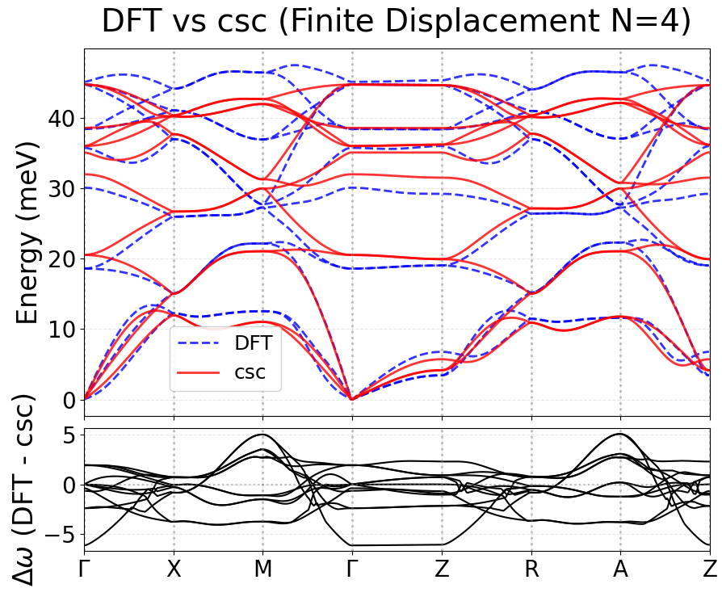
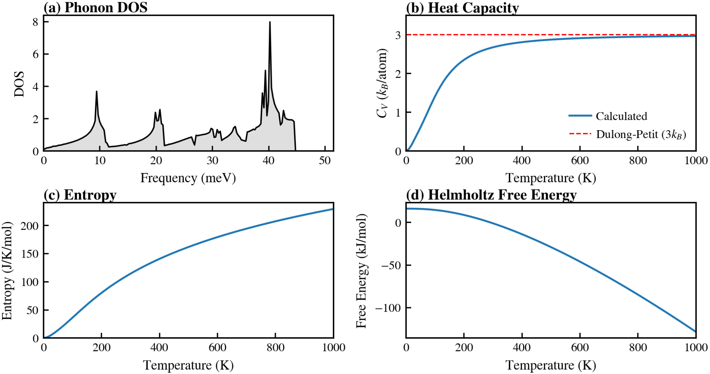

# FeSe｜VASP / DFT(+gRISB) → energy-only GAP → Phonopy

本目錄整理 FeSe 的結構生成、電子結構能量擷取、GAP/QUIP 位能擬合及聲子分析流程。這是**研究用範例**，部分程式需自行指定輸入檔、已訓練的 GAP XML 或 DFT 參考結果。

## 1. 工作流程

1. **生成結構**：`ASE/strain.py`、`rattle.py`、`shear.py`、`phonopy_disp.py` 產生應變、隨機位移、剪切與聲子位移構型。
2. **參考能量**：在 VASP（可搭配 DFT+gRISB 的 SCF/CSC 子目錄結構）計算每個構型的能量。
3. **資料轉換**：`ASE/create_xyz.py` 將 POSCAR 與對應能量整理成 extended XYZ。
4. **模型訓練**：`QUIP/QUIP指令` 展示含 two-body、three-body、SOAP 描述符的 GAP energy-only 設定。
5. **模型檢驗**：`QUIP/relax.py` 執行結構弛豫；`phonopy/` 計算聲子、振動熱性質，並與適用的參考結果比較。
6. **主動學習**：`phonopy/active_learning.py` 根據聲子模態誤差，建立新的待計算結構。

詳細資訊分別參閱 [ASE](ASE/README.md)、[QUIP](QUIP/README.md)、[Phonopy](phonopy/README.md)。

## 2. 主要檔案

| 路徑 | 功能或注意事項 |
| --- | --- |
| `ASE/create_xyz.py` | 掃描含 `scf/` 和 `csc/` 的計算目錄，輸出 `scf_data.xyz`、`csc_data.xyz` |
| `QUIP/energy_only_dataset.xyz` | 原本提供的 FeSe extended XYZ 範例，使用前請確認資料量與標記定義 |
| `QUIP/QUIP指令` | `gap_fit` 指令、`default_sigma`、描述符及 `e0` 參數 |
| `QUIP/relax.py` | 從指定 GAP XML 和 POSCAR 弛豫結構，模型路徑需修改 |
| `phonopy/QUIP_for_calc_phonon.py` | 從模型預測力建構 Phonopy 力常數 |
| `phonopy/QUIP_calc_with_eigenvector.py` | 輸出帶本徵向量的聲子頻譜 |
| `phonopy/active_learning.py` | 根據頻率差產生模態位移構型 |
| `phonopy/compare.py` | 參考計算與 MLIP 預測聲子的繪圖腳本；需提供有效 Phonopy 結果 |
| `phonopy/for_calc_some_use_thermal_properties.py` | 聲子 DOS、熱容、熵與自由能 |
| `phonopy/phonopy_disp.yaml` | **位移構型資訊**，不是包含 force constants 的完整 reference phonon band 檔 |
| `INCAR_scf`、`INCAR_csc`、`plo.cfg`、`grisb_config.toml` | VASP／DFT+gRISB 輸入設定 |

## 3. 資料擷取範例

從儲存庫根目錄執行：

```bash
python FeSe/VASP/ASE/create_xyz.py /path/to/calculation_root \
  --csc-out csc_data.xyz --scf-out scf_data.xyz
```

此腳本依目前程式邏輯使用 `csc/nohup.out` 的 total energy 與 `scf/OUTCAR` 的 free energy；兩者**不是可以直接混成同一能量標籤的等價數字**。還需要檢查每一筆的收斂情形、參考能量及計算條件。

要訓練 GAP，請參閱 `QUIP/QUIP指令`，確認 `gap_fit`、資料檔、描述符及孤立原子能量 `e0` 均符合目前環境。指令只是範例，不能保證在另一台機器上立即成功。

## 4. 圖稿及結果狀態





- 目前聲子圖的圖例是 **DFT / CSC**，不是 DFT / GAP；需核對計算方法與模型版本後才能將其用作 energy-only GAP 的性能比較。
- 熱性質圖包含 Phonon DOS、熱容、熵與自由能；熱容接近 3 \(k_B\)/atom 的高溫極限，僅提供物理一致性線索。
- 研究者提及「約 74 筆」資料的一次訓練經驗，**尚未確認**與此兩張圖、以及 `energy_only_dataset.xyz` 完全對應。
- 定量 RMSE、資料分割與最終模型設定待補充，現在不宣稱特定預測精度。

## 5. 重要提醒

- 請核對輸入 POSCAR、超胞大小、cutoff 與 k-point 設定，不同腳本不一定相同。
- 部分執行檔（VASP、gRISB 腳本、POTCAR）、模型 XML、計算輸出未收錄；使用者需自行準備合規的軟體與資料。
- `phonopy/phonopy_disp.yaml` 目前不能單獨重現 DFT 與 MLIP 聲子色散的完整對照。
- 對 DOS、熱容、熵與自由能等物性，需確認正規化單位、晶胞定義及 DFT 或實驗對照後才能作定量結論。
