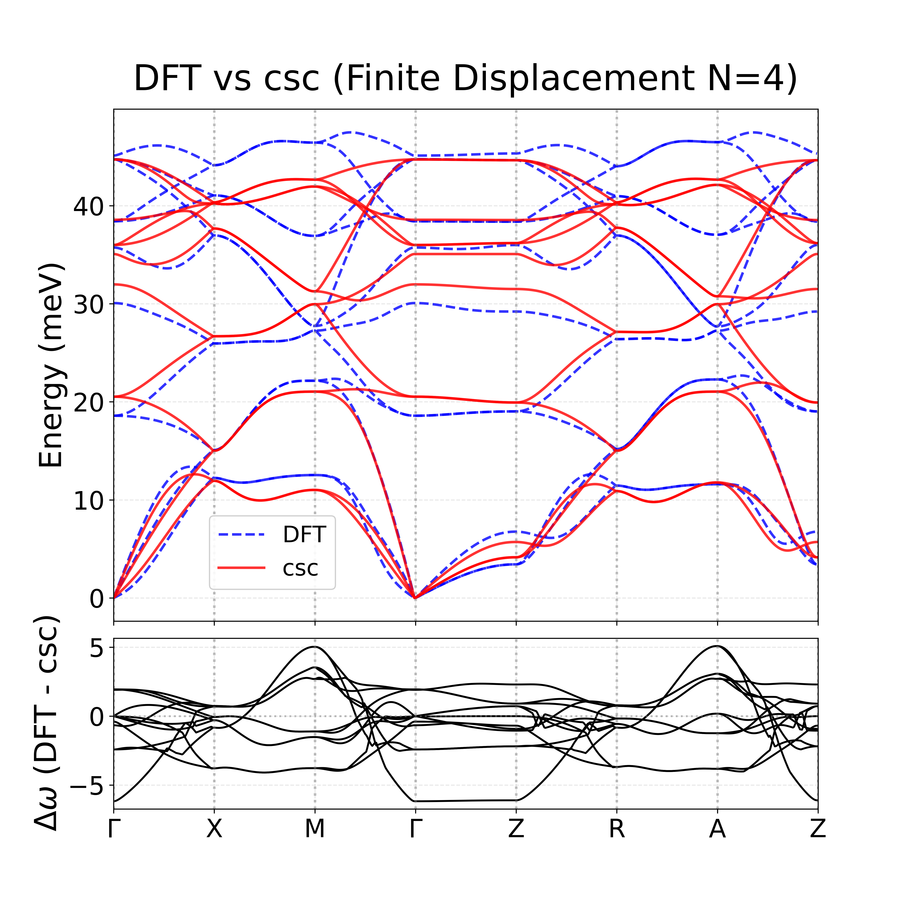
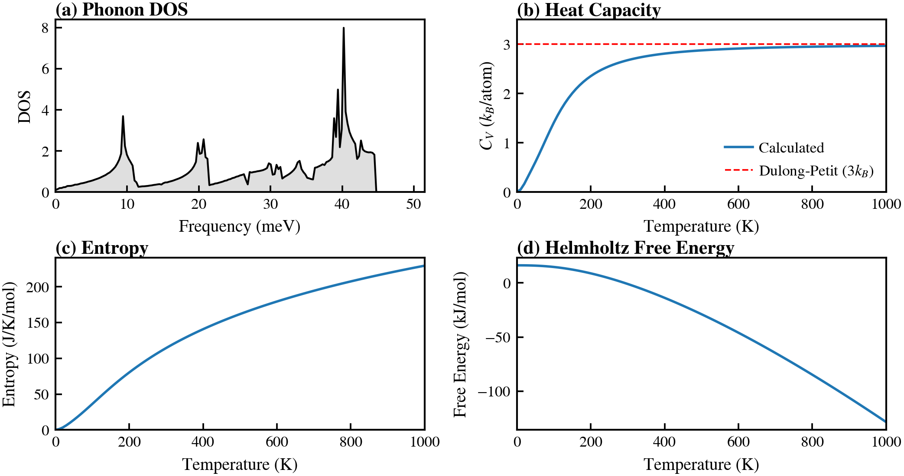

# CCU QUIP／MLIP Tutorial｜FeSe 與 Si 實作教學

本儲存庫整理國立中正大學（CCU）THLee Lab 的**機器學習原子間位能**（Machine-Learned Interatomic Potential, MLIP）研究範例，讓初次接觸 **QUIP／GAP、ASE 與 Phonopy** 的同學有可參考的程式、資料及操作說明。除了 FeSe 的完整流程，也收錄 Si 的 GAP 分子動力學、模型比較與 MACE 訓練指令。

**建議先從 FeSe 的 [U=J=0 五關教學](FeSe/VASP/QUIP/U0J0_pretest/README.md) 開始。** 這部分已保存訓練資料、GAP 模型、聲子參考資料及實際執行過的腳本。Si 的 MACE 訓練／驗證 XYZ 已提供，但模型權重與部分其他範例的輸入仍需自行準備，請依各自 README 使用。

## 教學導覽

| 範例 | 可以學到什麼 | 建議入口 |
| --- | --- | --- |
| **FeSe：完整 GAP → Phonopy** | 讀取 energy-only XYZ、使用與重新訓練 GAP、以預測力計算聲子、DOS 和熱力學性質 | [FeSe U0J0 教學](FeSe/VASP/QUIP/U0J0_pretest/README.md) |
| **FeSe：資料準備與其他研究程式** | ASE 生成 strain／rattle／shear、VASP／CSC 能量擷取、其他 QUIP 設定與聲子工具 | [FeSe/VASP/](FeSe/VASP/README.md) |
| **Si：GAP 模型應用** | 使用 ASE＋QUIP 執行矽的 NVT 分子動力學，並比較模型與 DFT 的能量／力／應力 | [Si 教學](Si/README.md) |
| **Si：MACE-MP-0 energy-only 微調** | 190／22 筆資料、parity plots、RMSE 與模型 SHA-256 | [Si/MACE/](Si/MACE/README.md) |

## 核心觀念：Energy-only 也能計算原子力

一般 MLIP 可以用能量、原子力與應力作為訓練標記。本專案的 energy-only 範例**僅以參考總能量監督訓練**；但模型仍可由預測能量對原子位置的負梯度得到原子力：

\[
\mathbf{F}_i=-\nabla_{\mathbf{R}_i}E_{\mathrm{MLIP}}.
\]

因此，**energy-only 不等於後續計算不使用力**。例如 Phonopy 就需要模型預測的位移原子力，才能建立二階力常數並求得聲子頻率。

請注意：**GAP／QUIP 與 MACE 是不同的模型框架**，模型檔案和 ASE calculator 不可直接混用。本儲存庫以 GAP／QUIP 為主要入門主題，MACE 為另外收錄的 Si 範例。

## FeSe｜從能量資料到聲子與熱力學

<details>
<summary>工作流程</summary>

```text
ASE 產生不同結構
       ↓
DFT／CSC 計算參考能量
       ↓
extended XYZ（結構 + energy）
       ↓
QUIP gap_fit（energy-only）
       ↓
GAP 預測能量與原子力
       ↓
Phonopy 聲子色散、DOS、Cv、Entropy、Free Energy
```

</details>

已整理的 **U=J=0 pre-test** 使用 74 筆 FeSe 總能量紀錄（每筆 32 顆原子，但只有 **59 個不同幾何**），訓練 2-body＋3-body GAP；教材包含原始模型、重新訓練、4×4×4 聲子重現及與 DFT 的比較。相關指令請直接參考 [完整教學](FeSe/VASP/QUIP/U0J0_pretest/README.md)。

下列圖片是歷史示例，保留作為學習與比較的參考。

### 聲子色散：DFT 與 energy-only GAP



藍色虛線是 DFT 參考聲子，紅色實線（歷史圖例標為 CSC）是以 CSC 總能量訓練的 GAP，**再透過 Phonopy 計算**的結果，並非直接的 CSC 聲子。這是 U=J=0 的流程示範，**不代表已驗證 FeSe 有限 U／J 的強關聯效應**。兩組結果的 relaxed geometry 並非完全相同，不宜將差異直接解讀成相同結構上的模型誤差。

### Phonon DOS 與振動熱力學



可利用 Phonopy 由聲子求出振動態密度（DOS）、定容熱容（`C_V`）、熵及 Helmholtz 自由能。高溫熱容趨近 `3 k_B/atom` 是一項物理一致性檢查，但不能取代與獨立 DFT 或實驗資料的定量驗證。

**資料不要混用：** [U0J0 pre-test](FeSe/VASP/QUIP/U0J0_pretest/) 的 `csc_data_74.xyz` 是 **74 筆／每筆 32 原子**；上層 [QUIP](FeSe/VASP/QUIP/) 的 `energy_only_dataset.xyz` 是另外一組 **440 筆／每筆 128 原子**，訓練指令和模型描述符均不同。

## Si｜GAP 與 MACE 的獨立範例

[Si/](Si/README.md) 目前提供三種用途：使用 GAP 進行矽晶體的 NVT 分子動力學、以參考資料計算 GAP 的能量／力／應力比較圖，以及使用 **MACE foundation model** 微調的 energy-only 訓練指令。

Si 的 GAP 與 MACE 範例**不是一套已串接的完整流程**。MACE 的 [訓練／驗證 parity plots 與 Si 熱導率](Si/MACE/README.md) 已收錄，XYZ 與模型 SHA-256 也已記錄；但 MACE 模型權重與 GAP Si XML 尚未收錄。**Si GAP／QUIP 目前是需要自行準備模型的選做範例，未提供模型或歷史誤差結果。** 請先閱讀 [Si README](Si/README.md)，勿把 MACE 權重誤當成 GAP XML。

## 環境與注意事項

依範例可能需要 Python、NumPy、[ASE](https://ase-lib.org/)、[QUIP／quippy](https://github.com/libAtoms/QUIP)、[Phonopy](https://phonopy.github.io/phonopy/)、Matplotlib、[MACE](https://github.com/ACEsuit/mace)，以及 VASP／DFT+gRISB 或 GPU／MPI 環境。**不是每個範例都需要安裝所有軟體**，以各子目錄 README 的說明為準。

- FeSe U0J0 的原始資料、模型與主要計算流程已通過重現測試；其他舊研究腳本可能需要補充輸入檔、修正路徑或依環境調整。
- energy-only 訓練資料上的低誤差屬於 *in-sample* 表現，不能直接代表對未知結構的預測能力。
- 本儲存庫不提供 VASP 的 `POTCAR`、大型計算暫存檔或無權再散布的軟體。
- 目前未附獨立 LICENSE；使用或再散布程式／資料前，請確認適用的授權與各方法的引用要求。
