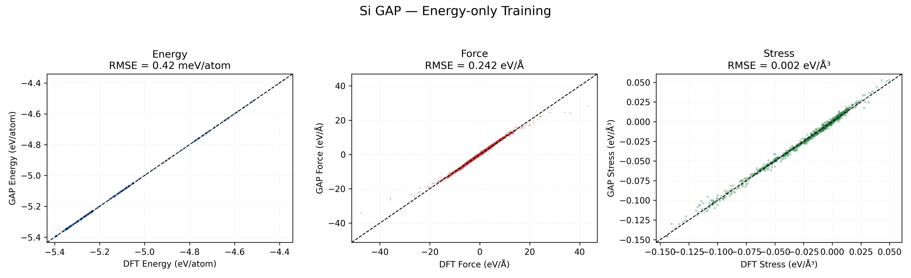
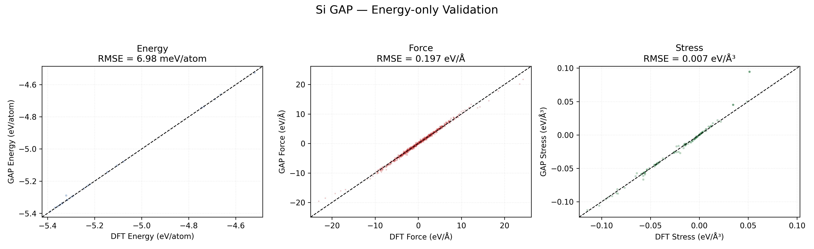

# Si GAP｜Energy-only 從資料準備到評估

這個範例以 190 個 Si 結構的 **total energy** 從頭訓練 GAP。`train_smart.xyz` 雖然也含 DFT forces 與 stress，實際送入 `gap_fit` 的 `si_train_energy_only.xyz` 只保留 energy；因此 force／stress RMSE 是訓練後的衍生預測能力，不是 force／stress supervision 的擬合結果。

## 已驗證結果

| 評估集 | 結構數 | Energy RMSE | Force RMSE | Stress RMSE |
| --- | ---: | ---: | ---: | ---: |
| Training：`train_smart.xyz` | 190 | 0.41955 meV/atom | 0.242087 eV/Å | 0.002202 eV/ų |
| Validation：`test_smart.xyz` | 22 | 6.98423 meV/atom | 0.197241 eV/Å | 0.006971 eV/ų |





`test_smart.xyz` 是 validation set，不是未參與任何選模或調參的獨立 test set。以上數值適合教學與工作流程檢查，不能單獨證明對所有未知 Si 結構的泛化能力。

資料稽核另發現 Training 的第 21 與 35 號 frame（從 0 起算）在元素順序、cell、座標及全部 labels 都完全相同，因此 190 筆中有 189 個不同的有序幾何；實際 fitting 仍讀入 190 筆，等於讓該構型出現兩次。Training 與 Validation 之間沒有發現相同的有序幾何，但目前檢查不具旋轉、原子重排或晶體對稱不變性。

## 參考資料的來源與適用範圍

本教學使用 repository 已附的 `../train_smart.xyz` 與 `../test_smart.xyz`，不需要為了重現 GAP 訓練與 RMSE 而重新做 DFT。這 212 筆 Si 標記**可能出自 GPAW**（依作者回憶），但原始計算輸入與參數尚未保存於本 repository，不能據此確認泛函、cutoff、k-points、收斂條件或上游 stress convention；本頁 Stress RMSE 僅以目前 XYZ 的 ASE 應力定義進行一致評估。

若要產生全新 Si 資料，可依研究需要使用 VASP、Quantum ESPRESSO（QE）或 GPAW，並自行驗證 DFT 收斂與標記一致性。**構型生成方法建議參考較完整的 [FeSe／ASE 範例](../../FeSe/VASP/ASE/README.md)**；其 `strain.py`、`rattle.py`、`shear.py` 和 `phonopy_disp.py` 可作為思路參考，但具有 FeSe／VASP 專用設定，不能直接當作 Si 或 QE 的即用程式。本教材不把舊 Si 結構生成腳本作為必要步驟。

## 目錄與環境

```text
Si/GAP/
├── prepare_energy_only.py   # 移除 force/stress labels
├── train_gap.sh             # 可重跑的實際 gap_fit 設定
├── evaluate.py              # training/validation RMSE、PNG、JSON
├── model/                   # XML 與 XML 真正引用的兩個 SparseX
└── results/                 # 本模型實算結果
```

需要 Python 3、ASE、NumPy、Matplotlib、QUIP 的 `quippy`；若要重新訓練，還需要 `gap_fit` 與 Open MPI。請使用同一套 QUIP build 的 `gap_fit` 和 `quippy`，避免 XML 相容性問題。

## 1. 準備 energy-only 訓練檔

從 repository 根目錄執行：

```bash
python3 Si/GAP/prepare_energy_only.py \
  --input Si/train_smart.xyz \
  --output /tmp/si_train_energy_only.xyz
```

程式會重新讀取輸出並確認 190 筆結構都只剩 `energy` label。原本的 `train_smart.xyz` 不會被修改。

## 2. 訓練（選做；現有模型不必重訓）

```bash
bash Si/GAP/train_gap.sh
```

預設以 `mpirun -np 4` 執行，輸出到未追蹤的 `Si/GAP/run/`；可用 `NPROCS=1` 單程序執行，或用 `RUN_DIR`、`GAP_FIT_BIN`、`PYTHON_BIN` 指定路徑。歷史實際指令是 `mpirun -np 4 gap_fit ... 2>&1 | tee GAP_Si_EnergyOnly.log`，XML 也保存了相同的 `gap_fit` arguments。交付前已用 `NPROCS=1 GAP_FIT_BIN=/bin/echo` 完成 mock-run，確認資料準備、工作目錄與 arguments 傳遞正確；沒有重新執行完整訓練。

| 設定 | 實際值 |
| --- | --- |
| labels | `energy_parameter_name=energy`；輸入檔沒有 force/stress/virial labels |
| sigma | `default_sigma={0.002 0.0 0.0 0.0}` |
| E0 | `e0_method=average`；模型中的 Si E0 = −5.1020273161189191 eV/atom |
| 2-body | cutoff 5.0 Å、delta 1.0、ARD-SE、theta 1.0、uniform、`n_sparse=50` |
| SOAP | cutoff 5.0 Å、delta 1.0、`l_max=6`、`n_max=8`、`atom_sigma=0.5`、dot-product、zeta 4、CUR、`n_sparse=1000` |

`default_sigma` 的後三項為 0 不會產生 force／virial labels；是否有 supervision 取決於輸入 XYZ。訓練 log 顯示 190 個 energy observations，descriptor partial derivatives 為 0。

## 3. 載入模型

XML 依檔名尋找同目錄 SparseX，所以三個模型檔必須一起保留：

```python
from ase.io import read
from quippy.potential import Potential

atoms = read("Si/test_smart.xyz", index=0)
calc = Potential(param_filename="Si/GAP/model/GAP_Si_EnergyOnly.xml")
atoms.calc = calc
print(atoms.get_potential_energy())
print(atoms.get_forces().shape)
```

| 模型檔 | XML 記錄的 MD5 |
| --- | --- |
| `GAP_Si_EnergyOnly.xml.sparseX.GAP_2026_10_13_480_9_48_18_3441` | `7005f7d0ae5b268ecc333b8e86721352` |
| `GAP_Si_EnergyOnly.xml.sparseX.GAP_2026_10_13_480_9_48_18_3442` | `f96cdbdb214a51ea75961c4a1089b9c8` |

來源資料夾中的 `309*`、`313*`、`333*` 是舊訓練嘗試，現有 XML 沒有引用，因此沒有收進 `model/`；原始檔仍保留在使用者的計算資料夾。

## 4. 評估 Training／Validation

```bash
python3 Si/GAP/evaluate.py --split both
python3 Si/GAP/evaluate.py --split training
python3 Si/GAP/evaluate.py --split validation
```

`--split both` 會產生兩張 parity plots 與 `results/metrics.json`；單獨 split 會產生對應的 `*_metrics.json`。程式先複製 DFT labels，再用 `atoms.calc = calc` 安裝 GAP calculator。

Energy 先除以每個 frame 的原子數；force RMSE 使用所有笛卡兒分量；stress RMSE 使用 ASE Voigt 六分量 `[xx, yy, zz, yz, xz, xy]`。本資料的 `stress` 是 eV/ų，ASE 正號代表拉伸。若輸入只有 virial（eV），程式會用 `stress = -virial / volume` 轉換，不會把 virial 直接當 stress。

## 5. 與 MACE-MP energy-only 比較

| 模型 | 訓練起點 | Validation Energy | Validation Force | Validation Stress |
| --- | --- | ---: | ---: | ---: |
| 本例 GAP | 從頭訓練 | 6.98423 meV/atom | 0.197241 eV/Å | 0.006971 eV/ų |
| MACE-MP | foundation model fine-tuning | 3.10 meV/atom | 0.16228 eV/Š| 0.0022 eV/ų |

兩者使用相同 validation 資料與 RMSE 定義，但不是純架構的公平比較：GAP 從零開始只看本資料的 energies；MACE-MP 在 fine-tuning 前已從大型資料集預訓練，force／stress 能力可能來自 foundation model。MACE 細節請看 [`../MACE/README.md`](../MACE/README.md)。

## 舊 GAP 範例不要混用

`Si/MD.py` 與 `Si/RMSE.py` 是舊 `GAP_Si_Final.xml` 流程，該模型使用 energy 加上 force／virial-stress 相關監督；舊模型**未收錄於 repository**，因此舊腳本不能直接執行，也不能把它們當成新 Energy-only GAP 的示範。本次沒有覆寫舊腳本、MACE 結果或 FeSe 資料，模型名稱與結果目錄也完全分開。
