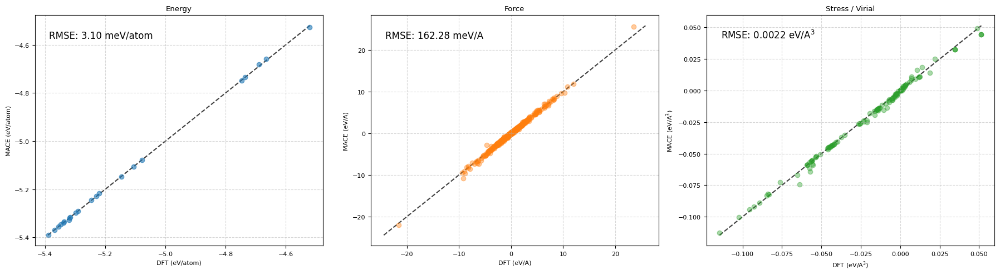
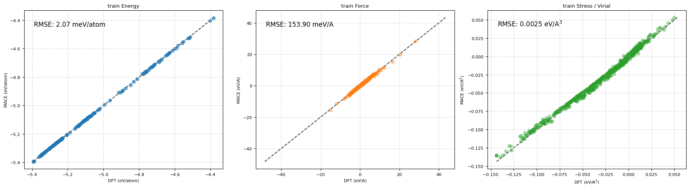
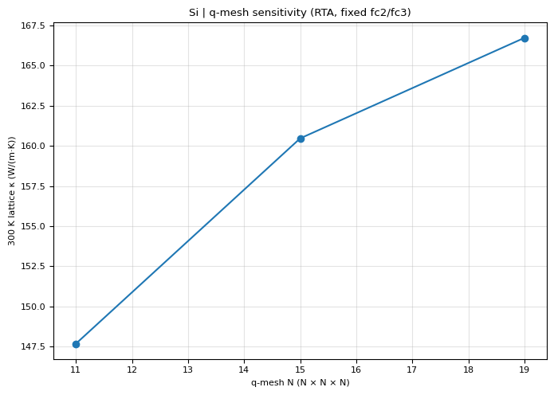
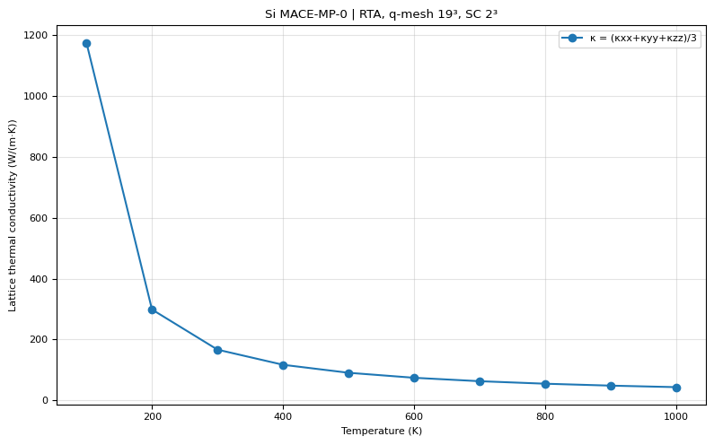

# Si｜MACE-MP-0 energy-only 微調與評估

本範例使用預訓練 **MACE-MP-0（Medium）**，以 Si DFT 能量進行 **energy-only fine-tuning**。微調的 force／virial 損失權重設為零，但保留 DFT energy、forces、stress labels 供模型評估。請勿將 MACE checkpoint 用在 GAP／QUIP calculator。

## 已驗證的結果

| 項目 | 設定 |
| --- | --- |
| Foundation | mace_mp.model（MACE-MP-0） |
| 訓練完成 checkpoint | Si_MACE_only_energy_r_max5_TRUE_BLIND_run-123_stagetwo.model |
| SHA-256 | 929b2f5bf41f32f2eea1d0346e78a5c4f6d1d781d8167fa356b7ff87251ac549 |
| 環境／精度 | MACE 0.3.14、float64 |
| r_max | 5.0 Å |
| 微調 | 200 epochs；SWA 從 epoch 150 開始；seed 123 |
| Loss | Energy weight 10；force/virial（含 SWA）weight 0 |
| Training | [train_smart.xyz](../train_smart.xyz)，190 個結構 |
| Validation | [test_smart.xyz](../test_smart.xyz)，22 個結構 |

Checkpoint 權重**未收錄於 repository**，但其名稱和 SHA-256 已記錄。另一份檔名沒有 run-123 的模型雖然檔案 SHA 不同，在 22 筆 validation 結構上的 energy／force 預測與 checkpoint 幾乎完全一致；本頁圖片改以訓練紀錄明確指定的 run-123 checkpoint 重新評估。

| 評估集 | Energy RMSE | Force RMSE | Stress RMSE |
| --- | ---: | ---: | ---: |
| Training (190) | 2.07 meV/atom | 153.90 meV/Š| 0.0025 eV/ų |
| Validation (22) | 3.10 meV/atom | 162.28 meV/Š| 0.0022 eV/ų |

### Validation：DFT vs MACE

### Training：DFT vs MACE

圖片來自已完成的 Colab Notebook「MACE_for_Silicon_only_energy_r_max5 (3).ipynb」的兩個評估 cell；**不是示意圖**。Force 散點為最多 1000 個分量的繪圖抽樣，但圖上 RMSE 使用全部原子力分量。Stress 為 ASE get_stress() 的六維 Voigt 應力（eV/ų），不是直接拿 virial 當 stress。

**如何解讀：** 這不是「從零開始只用 Si energy 訓練」的模型，而是已有預訓練知識的 MACE-MP。test_smart.xyz 在訓練指令內是 validation file，**不是最終獨立 holdout**。train／validation 的完整資料來源與對稱等價去重尚未完成，因此不宜宣稱已證明未知結構的泛化能力。可先執行 repository 內的 python Si/check_datasets.py，檢查有序幾何是否重複；它不包含晶體對稱判別。

可機讀的來源與數字見 [results/metrics.json](results/metrics.json)。

## 重現 parity plots（無須再訓練）

需要 ASE、NumPy、Matplotlib、PyTorch、MACE。模型請使用你自己訓練或可信來源的完整 checkpoint。從 repository 根目錄執行：

~~~bash
python Si/MACE/evaluate_parity.py \
  --model /path/to/Si_MACE_only_energy_r_max5_TRUE_BLIND_run-123_stagetwo.model
~~~

程式會自動使用 CUDA 或 CPU；可用 --device cuda 或 --device cpu 指定。只需 validation 圖可加 --split validation。它先讀 DFT 參考值再安裝 MACECalculator，並固定 force 繪圖抽樣種子；新的 PNG 與 metrics.json 輸出於 Si/MACE/results/recomputed/，**不會覆寫此頁歷史圖**。

## 兩份原始訓練指令

- [MP0指令](MP0指令)：載入 mace_mp.model，float64、200 epochs、SWA 150；本頁主要實驗。
- [沒有MP0](沒有MP0)：名稱具有誤導性；仍指定 mace_mp_f32.model，因此也是 foundation-model fine-tuning，而非從頭訓練（float32、100 epochs）。

這兩份是 Colab 指令，以 !python3 開頭；若在一般終端機執行請移除 !。模型與 XYZ 路徑是相對於執行目錄；原始資料在上一層 Si/，建議在 Si/ 執行或調整 --train_file 與 --valid_file。foundation model 的授權、版本及詳細安裝資訊見 [MACE 官方專案](https://github.com/ACEsuit/mace)。

## 晶格熱導率（Phono3py）

使用**上方同一份 `run-123_stagetwo.model` checkpoint**，以 Phono3py 計算 Si 三階力常數及晶格熱導率。這裡的圖直接擷取自已成功跑完的 Colab Notebook `MACE_for_Silicon_only_energy_r_max5 (5).ipynb`（Cell 20）；**不是以程式假造的圖，也不是舊版 5.587 Å 晶格的結果**。

### 模型與物理設定

| 項目 | 本次設定 |
| --- | --- |
| checkpoint SHA-256 | `929b2f5bf41f32f2eea1d0346e78a5c4f6d1d781d8167fa356b7ff87251ac549` |
| Si conventional cubic a（模型弛豫） | 5.47483406 Å |
| 對稱晶胞的最大 |F|／|stress| | 3.22×10⁻¹⁵ eV/Å／1.73×10⁻⁸ eV/ų |
| fc2／fc3 supercell | 2×2×2 conventional（64 atoms） |
| 位移大小及數量 | 0.03 Å，111 個位移構型 |
| 晶格熱導率 | Phono3py 單模 RTA，三聲子散射 |
| 未包含的散射 | isotope、boundary |
| 300 K q-mesh | 11³、15³、19³ |
| 溫度掃描 | 100–1000 K，19³ q-mesh |

### 300 K q-mesh 敏感度

| q-mesh | κxx = κyy = κzz（W/(m·K)） |
| --- | ---: |
| 11³ | 147.687 |
| 15³ | 160.468 |
| 19³ | **166.725** |

15³ 到 19³ 的結果相差約 **3.75%**（以 19³ 作分母）。這只是**固定 2×2×2 超晶胞與相同 fc2／fc3 的 q-mesh 敏感度檢查**，不能稱為「整個熱導率已收斂」。單一模型的預測也不能當作獨立 DFT／實驗驗證。

### 100–1000 K 熱導率

| T (K) | κ (W/(m·K)) | T (K) | κ (W/(m·K)) |
| ---: | ---: | ---: | ---: |
| 100 | 1176.209 | 600 | 74.322 |
| 200 | 298.748 | 700 | 63.046 |
| 300 | 166.725 | 800 | 54.793 |
| 400 | 117.023 | 900 | 48.479 |
| 500 | 90.731 | 1000 | 43.486 |

晶格熱導率是三個對角方向 (κxx+κyy+κzz)/3 的平均值。本例高度對稱，三方向計算結果相同；低溫數值尤其會對散射模型、q-mesh 和系統尺寸敏感，**不應直接將 100 K 預測宣稱為實驗準確值**。

### 重現與輸出

程式：[thermal_conductivity.py](thermal_conductivity.py)（擷取自**已實際成功執行**的 Cell 20；原始 Drive 路徑可於檔案開頭 `ROOT` 修改）。先安裝 MACE、ASE、Phonopy、Phono3py 並備妥可信 checkpoint；這是計算程式，會重新產生力常數，**不是訓練 MACE 的程式**。

原 Notebook 顯示結果儲存至：

`/content/drive/MyDrive/xyz_for_training/Si_thermal_results/run_20261012_155035/`

該次程式會產出 q-mesh／溫度 CSV、兩張 PNG、含力常數的 `phono3py_params_with_fc.yaml` 與 `settings.json`。本 repository 收錄**兩張已保存於 Notebook 的圖片與依輸出整理的 [thermal_metrics.json](results/thermal_metrics.json)**，但沒有取得或上傳原本 Drive 裡的完整 CSV／force-constants YAML；要完全重現力常數可用上述腳本再計算。

**限制：** 尚未執行超晶胞尺寸、位移量、LBTE（非 RTA）或與實驗／獨立 DFT 的完整交叉驗證。本結果可作為工作流程示範，不能當成已達研究精度的材料常數。
